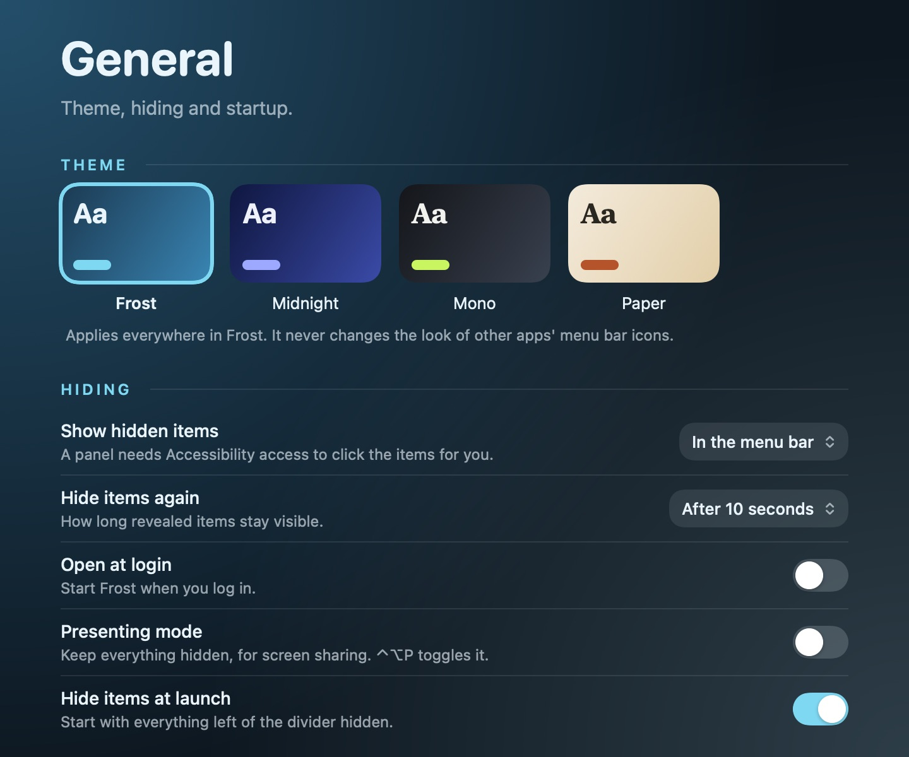
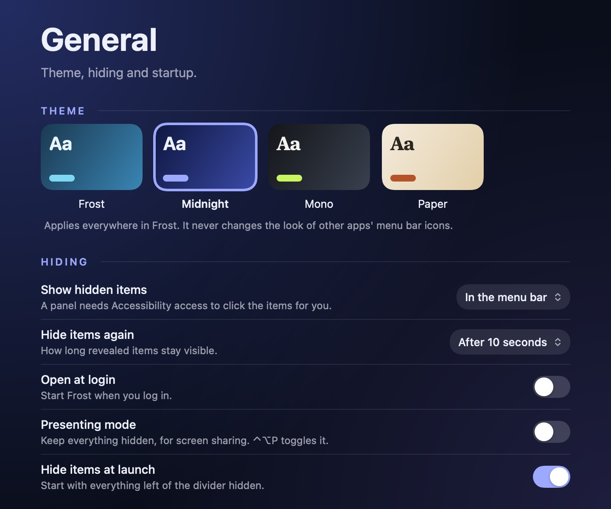
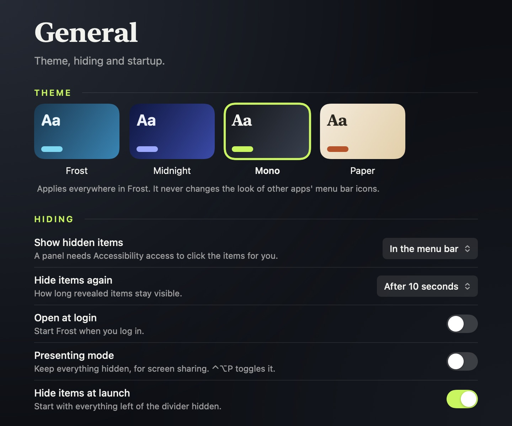
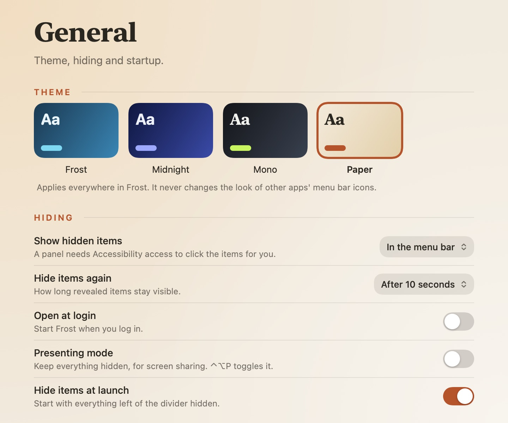
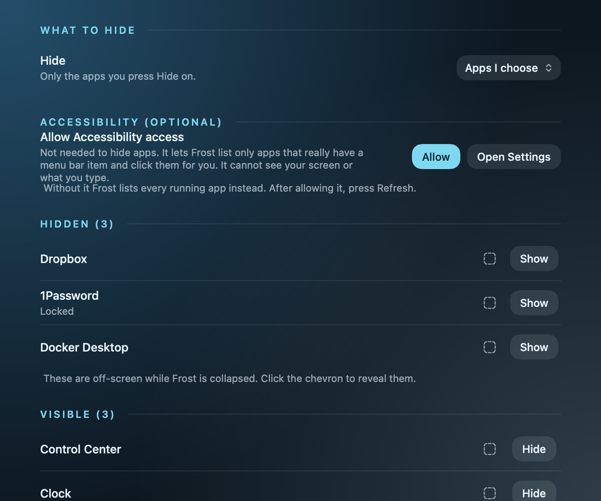
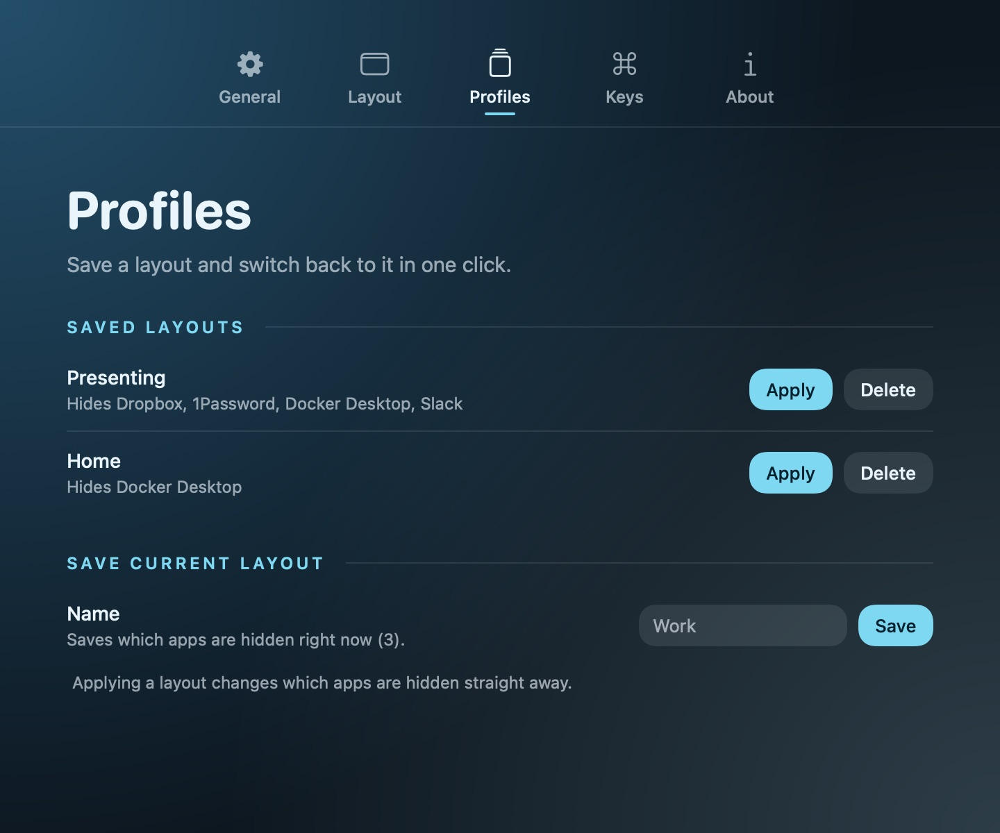
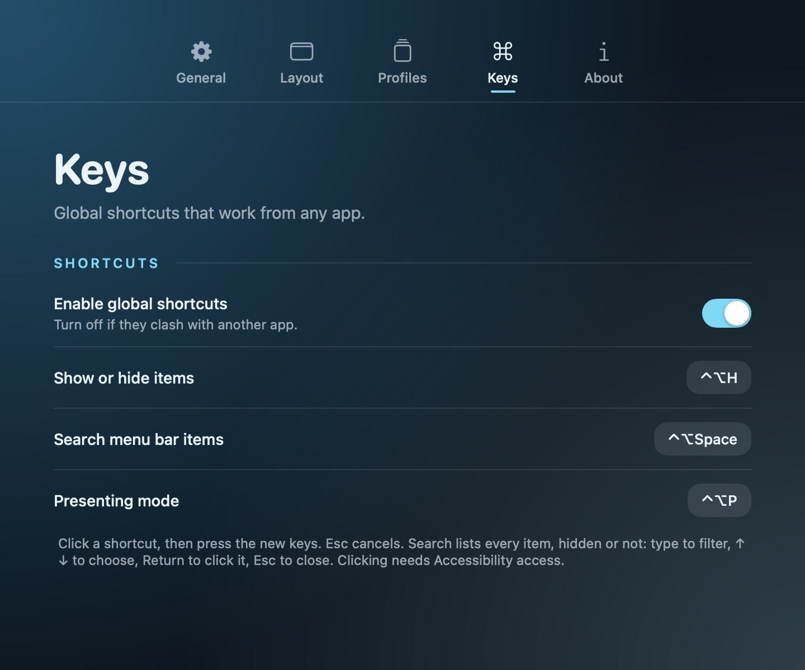

# Frost

A macOS menu bar organiser. Frost hides the icons you do not need all the time, shows them on demand, and keeps every one of them reachable by search and keyboard. It is built for crowded and notched menu bars.

Open source, no accounts, no telemetry, no network calls. Settings stay on your Mac.

<p align="center"></p>

<table>
  <tr>
    <td align="center"><br>Midnight</td>
    <td align="center"><br>Mono</td>
    <td align="center"><br>Paper</td>
  </tr>
  <tr>
    <td align="center"><br>Layout</td>
    <td align="center"><br>Profiles</td>
    <td align="center"><br>Keys</td>
  </tr>
</table>

<sub>Images are rendered by the app itself (`Frost --snapshot <folder>`) with sample data, so the real macOS background blur isn't visible in them.</sub>

## Features
- **Hide and show:** a divider and chevron in the menu bar. Everything left of the divider is hidden until you click the chevron (or press ⌃⌥H by default). Revealed items hide again after a delay you choose.
- **Panel mode:** show hidden items in a themed panel under the menu bar instead of the bar itself. Click a tile to click the real item.
- **Layout:** the Layout tab lists every item, hidden or visible, with **Hide** and **Show** buttons that move the icon for you.
- **Search:** ⌃⌥Space lists every item. Type to filter, ↑ ↓ to choose, Return to click it.
- **Profiles:** save which apps are hidden as a named layout and apply it later.
- **Presenting mode:** keep everything hidden for screen sharing (⌃⌥P).
- **Themes:** Frost, Midnight, Mono and Paper. A theme only styles Frost's own windows, never other apps' icons.
- Open at login, global shortcuts you can change in Settings → Keys or switch off. Defaults: ⌃⌥H show or hide, ⌃⌥Space search, ⌃⌥P presenting mode.

## How hiding works
- **macOS 26 and earlier:** a divider in the menu bar grows wide and pushes the icons left of it off the edge.
- **macOS 27:** that no longer works, so Frost uses the system menu bar allow-list (a private Apple API, loaded at run time) to hide whole apps. It hides per app rather than per icon, hides the Focus and camera indicators while on, and **requires Frost to run from /Applications** (`./install.sh` does that). If a macOS update removes the API, Frost falls back to the divider and says so in About.

## Permissions
Hiding on macOS 27 needs no permission. Frost can also ask for **Accessibility**, and explains why before you grant it: it lets Frost list only apps that really have a menu bar item, click them for you and (before macOS 27) move them. It cannot see your screen or what you type. Without it Frost still hides and shows apps, but lists every running app and cannot click items for you.

## Install
1. Download `Frost-<version>.dmg` from the GitHub releases page, open it and drag **Frost** to **Applications**.
2. Open Frost **from Applications**. On macOS 27 hiding only works from there.
3. Frost is not notarized, so macOS blocks it once: go to System Settings → Privacy & Security and choose **Open Anyway**.
4. Follow the first-run setup. Accessibility is optional.

Or with Homebrew: `brew tap dhri-yama/tap && brew install --cask frost`.

**Updates and permissions.** There is no auto-update yet; download the new DMG. Because releases are not signed with a paid Apple Developer ID, macOS may ask you to allow Accessibility again after an update.

## Build
Requires macOS 13+ and the Swift toolchain (Command Line Tools are enough).

```sh
./test.sh          # run the tests
./bundle.sh        # build Frost.app (universal, signed)
open Frost.app
./dmg.sh           # build Frost-<version>.dmg
```

### Keeping the Accessibility permission across rebuilds
Ad-hoc signed builds change identity on every build, so macOS forgets the permission. Run `./make-dev-cert.sh` once to create a local "Frost Dev" certificate; `./bundle.sh` then uses it automatically. After the first signed build, reset once with `tccutil reset Accessibility io.github.dhri-yama.frost` and allow Frost again.

## Diagnostics
- `Frost --scan` prints the menu bar items Frost can find and which method it used.
- `Frost --snapshot <folder>` renders every settings pane in every theme to PNG.

## Releasing
`./release.sh <major|minor|patch>` bumps `VERSION`, stamps the `[Unreleased]` section of `CHANGELOG.md` and tags the release. Versions follow [Semantic Versioning](https://semver.org/); see `CHANGELOG.md`.

## Design
See `PRODUCT.md`, `docs/design-direction.md` and `docs/plan.md`.

## License
MIT. See `LICENSE`. Credits to the projects Frost builds on are in `CREDITS.md`.
